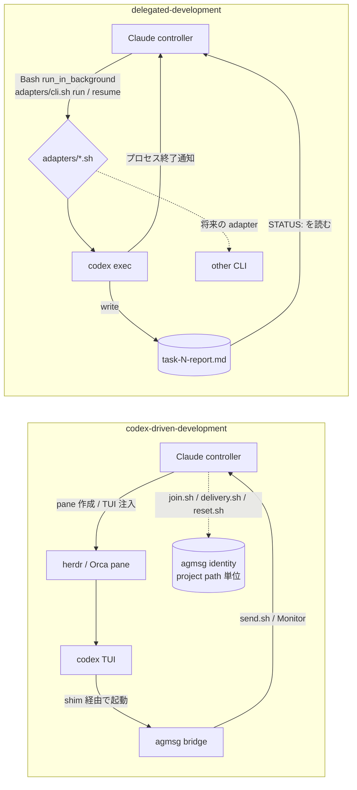
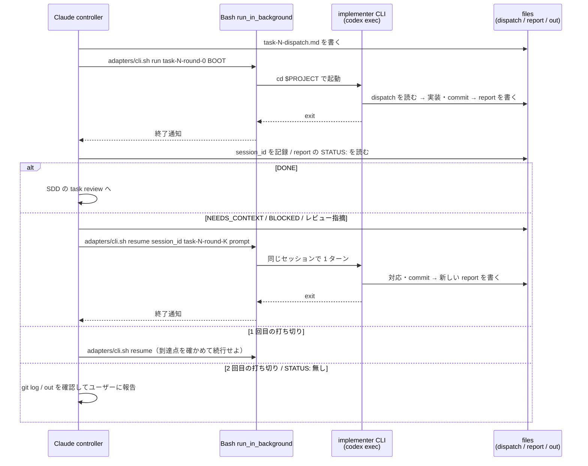

# delegated-development Design

## Intent

`codex-driven-development` skill（`.claude/skills/codex-driven-development/`）を、実装役 CLI を adapter で差し替えられる `delegated-development` skill に置き換える。
実装役 CLI は「非対話モードで 1 ターン実行し、終了したら結果を読む」形で駆動する。最初に実装する adapter は Codex（`codex exec`）だけで、ほかの CLI は adapter を足して追加する。

現行 skill の負担はどちらも agmsg 由来である。

- push mode の bridge を動かすために `codex-shim.sh`（shell profile の関数か PATH shim）が必要で、skill の外に事前設定がある
- agmsg の identity が project path 単位のため、`PROJECT`・`TEAM` の導出、worktree での `AGMSG_RESOLVE_PROJECT=0`、Run Teardown の `reset.sh` といったパス管理が skill に乗っている

ユーザーは implementer の pane を横で見たり途中介入したりする運用をほとんどしていないため、pane（herdr/Orca）と agmsg を両方外せる。

## Goals

- `codex-shim.sh`・agmsg・multiplexer（herdr/Orca）に依存せずに、SDD の implementer を外部 CLI に委譲できる
- ユーザーも skill の手順も、project path を登録・解除しない（CLI は作業ディレクトリで起動するだけ）
- 実装役 CLI ごとの差分を `adapters/<cli>.sh` に閉じ、CLI の追加を adapter スクリプトとそのテストの追加だけで済ませる
- 現行 skill の運用知見（Batching Strategy、Dispatch 前チェック、環境不備を implementer に埋めさせない規約、BLOCKED の扱い）を引き継ぐ

## Non-Goals

- Codex 以外の adapter の実装（構造だけ用意する。追加条件は Adding an Adapter 参照）
- implementer の作業画面をリアルタイムで見る・途中で介入する機能
- 複数 implementer の並行実行（SDD どおり 1 度に 1 implementer）
- implementer の model 指定（`.claude/skills/codex-driven-development/SKILL.md` の Substitutions「既定モデル」を維持。deprecated model の対話ダイアログで無人実行が止まるリスクを避ける）
- agmsg 自体のアンインストールや CLAUDE.md の `## agmsg` 節の変更（agmsg は他用途で残る）

## Anti-Goals

- 実装役の起動や設定のために、shell profile・PATH・agmsg の team / identity といった skill 外の状態をユーザーに用意させる
- 打ち切り線の無い待機（implementer がハングしたとき controller が永久に待つ）
- 利用規約が第三者ツールからの起動を禁じている CLI を adapter にする（Adding an Adapter 参照）
- Codex Claude Code plugin（`codex-companion.mjs`）経由での呼び出し（Approaches 参照。worktree で commit できない）

## Constraints

検証レベル付きで記す。

- VERIFIED: `codex exec --json -o <file> "<prompt>" </dev/null` は stdout の JSONL に `{"type":"thread.started","thread_id":"<uuid>"}` を出し、`-o` のファイルに最終メッセージを書く。git worktree 内で `git commit -s` まで完了した（codex-cli 0.169.0）
- VERIFIED: `codex exec resume <thread_id> -o <file> "<prompt>" </dev/null` は前ターンの文脈を保持して応答した
- VERIFIED: `codex-companion.mjs task --write` は sandbox を `workspace-write` に固定し（`scripts/codex-companion.mjs:491`）、worktree 内の `git add` が `.../.git/worktrees/<name>/index.lock: Operation not permitted` で失敗した。`~/.codex/config.toml` の `sandbox_mode = "danger-full-access"` は上書きされる
- VERIFIED: Codex が許可確認なしで書き込み・commit できるのは `~/.codex/config.toml` の `approval_policy = "never"`・`sandbox_mode = "danger-full-access"` による。skill はこれらを CLI 引数で上書きせず、ユーザー設定に任せる
- VERIFIED: この Mac には `timeout`/`gtimeout` が無く、`/usr/bin/perl` はある
- VERIFIED: `perl -e 'alarm shift; exec @ARGV' 40 codex exec ...` は終了コード 142 で codex を止めるが、codex が起動したシェルコマンド（`sleep 113`）は孤児として残った。`setpgrp` してプロセスグループを kill しても残った（codex はツールコマンドを別プロセスグループで起動する）。`pgrep -P` で子孫を再帰的に列挙して TERM → 2 秒後 KILL する perl ラッパーでは孤児は残らなかった
- `~/.claude/CLAUDE.md` は dotfiles の `.claude/CLAUDE.md` への symlink であり、変更対象はリポジトリ側の 1 ファイルだけ
- REASONED: 非対話モードは trust / hooks review / update といった起動時ダイアログを出さない（上記の検証で一度も出なかった）。出た場合は CLI がエラー終了するか、打ち切り線で止まる
- Claude Code の Bash `run_in_background` は終了時に controller へ通知する。Await はこの通知を第一信号にする

## Approaches

### Considered

1. **1 skill + CLI ごとの adapter スクリプト（採用）**
   進め方は 1 つの SKILL.md、CLI ごとの差（起動・再開・結果の取り出し・打ち切り）は `adapters/<cli>.sh` に置く。
   CLI を足すときに本文を触らずに済み、操作の実装がテストできる。代わりに skill 名を変える必要があり、シェルスクリプトとテストの保守が増える。
   adapter を 1 つの Markdown（現行の `multiplexer-adapters.md` 型）や CLI ごとの Markdown に書く案は、CLI を足すほどファイルが肥大化するか、コマンドの組み立て・ID 抽出・終了コード判定を Claude が毎回手で行ってぶれ、テストも書けないため不採用。
2. **CLI ごとに skill を分ける**
   各 skill は自分の CLI だけ書けばよいが、本文がほぼ同一のまま CLI の数だけ保守することになる。不採用。
3. **Codex だけを前提に adapter を持たない**
   間接参照が無くなるが、ユーザーは Codex 以外の CLI も使う予定で、追加のたびに本文を書き換えることになる。不採用。
4. **Codex は Codex plugin（`codex-companion.mjs task --write`）経由**
   job 管理・`--resume-last` を plugin が持つが、sandbox が `workspace-write` 固定で worktree 内で commit できない（Constraints 参照）。Claude が代理 commit すると TDD の段階 commit が失われ、sandbox 内で動かない検証も出る。不採用。`codex:codex-rescue` subagent 経由も同じ plugin を通るうえ、subagent の Bash は前景 10 分上限のため長い実装で打ち切られる。

### Decided by the user

- 構成は Approach 1。adapter は Codex 以外も使う前提で残し、CLI ごとのスクリプト（`adapters/<cli>.sh`）に分ける
- skill 名は `delegated-development`
- Codex は `codex exec` を直接使う（Codex plugin は使わない）
- `bound` で打ち切られたら同じセッションに 1 回だけ自動で続行を依頼し、2 回目の打ち切りでユーザーに報告する
- Antigravity CLI（`agy`）は adapter にしない（Adding an Adapter 参照）

## Design

### Overview

現行は pane・agmsg bridge・shim を経由して生きた TUI と通信する。本 skill は CLI の非対話モードを 1 ターンずつ起動し、プロセス終了を完了信号にする。



### Task Lifecycle

1 タスク（またはバッチ）の Dispatch → Await → Redispatch の流れ。



### Files

```
.claude/skills/delegated-development/
├── SKILL.md                 進め方（Prerequisites / Setup / Substitutions / Batching Strategy /
│                            Dispatch / Await / Redispatch / Abort / Failure Modes / Red Flags）
├── implementer-adapters.md  adapter スクリプトの契約、Adding an Adapter の条件、CLI ごとの規約確認記録（1 CLI 1 行）
├── dispatch-prompt.md       現行 codex-dispatch-prompt.md から multiplexer・agmsg 依存を除いた汎用テンプレート
├── bound.pl                 打ち切りラッパー
├── adapters/
│   └── codex.sh             codex の adapter
└── tests/
    ├── bound.test.sh        bound.pl のテスト
    └── codex.test.sh        codex.sh のテスト（PATH 先頭に置いた stub codex で引数と出力解析を検証）
.claude/skills/codex-driven-development/   削除
.claude/CLAUDE.md                          Plan Execution の選択肢 1 を delegated-development に書き換え、
                                           ### codex-driven-development 節（watch.sh の並行 worktree 手順）を削除
```

`bound.pl <seconds> <argv...>` は argv を子として起動し、時間切れで子孫プロセスを `pgrep -P` で再帰列挙して TERM → 2 秒後 KILL し、終了コード 142 で終わる。時間内に終われば子の終了コードを返す。

`~/.claude/skills/` 側の symlink（ansible 管理外。`~/.claude/skills/codex-driven-development/` は 3 ファイルの個別 symlink）は、リポジトリ外の作業として plan の最後に置く: `~/.claude/skills/delegated-development/` を作って `SKILL.md`・`implementer-adapters.md`・`dispatch-prompt.md`・`bound.pl` を個別 symlink、`adapters/` をディレクトリごと symlink し（`tests/` は張らない）、`~/.claude/skills/codex-driven-development/` を削除する。

### Adapter Contract

各 adapter は `adapters/<cli>.sh` という実行可能スクリプトで、次の subcommand を実装する。SKILL.md は subcommand だけを呼び、CLI 固有のフラグ・出力形式を知らない。

| subcommand | 動作 | 終了コード / 出力 |
|---|---|---|
| `detect` | CLI が使えるか | 使えれば 0 |
| `run <out> <prompt>` | `cd` 済みの作業ディレクトリで新規セッションを 1 ターン実行し、生出力を `<out>.*` に書く | 0: 成功 / 142: 打ち切り / その他: 失敗 |
| `resume <session_id> <out> <prompt>` | 同じセッションで 1 ターン実行 | `run` と同じ |
| `session_id <out>` | `<out>.*` から再開用 ID を stdout に出す | 取れなければ非 0 |
| `last_message <out>` | `<out>.*` から最終応答を stdout に出す | 取れなければ非 0 |

- 打ち切り線は adapter の責務で、`run`/`resume` は `WAIT_BUDGET`（環境変数、既定 1800 秒）で必ず終わる。CLI 固有の打ち切り表現は終了コード 142 に正規化する
- 出力の解析は jq を使わず grep / sed で行う（新しい依存を足さない）

codex adapter の実装:

| subcommand | codex |
|---|---|
| `detect` | `command -v codex` |
| `run` | `bound.pl "$WAIT_BUDGET" codex exec --json -o "$OUT.last" "$PROMPT" </dev/null >"$OUT.jsonl"` |
| `resume` | `bound.pl "$WAIT_BUDGET" codex exec resume "$ID" --json -o "$OUT.last" "$PROMPT" </dev/null >"$OUT.jsonl"` |
| `session_id` | `$OUT.jsonl` の `thread.started` 行の `thread_id` |
| `last_message` | `$OUT.last` の内容 |

どの subcommand も `cd "$PROJECT"` した shell で実行する（`PROJECT` は作業対象ディレクトリの絶対パス。登録先ではなく cd 先としてだけ使う）。

### Adding an Adapter

CLI を adapter に加える前に、次をすべて満たすことを確かめる。確認結果は `implementer-adapters.md` の表に CLI 1 つにつき 1 行（CLI 名・バージョン・確認日・規約の参照 URL）で書き、`adapters/<cli>.sh` と `tests/<cli>.test.sh` を追加する。

1. 利用規約が、別の AI エージェント（Claude Code）から非対話モードで無人・反復起動することを禁じていない
2. 非対話モードで 1 ターン実行し、終了コードで成否が分かる
3. 再開用のセッション ID を機械的に取り出せ、その ID で文脈を保ったまま再開できる
4. worktree 内で `git commit -s` まで完了できる
5. 打ち切りで子孫プロセスが残らない（CLI 自身の timeout か `bound.pl`）

Antigravity CLI（`agy` 1.5.12）は 2〜5 を満たすことを確認した（`-p --output-format json` の `conversation_id`、`--conversation` での再開、worktree での commit、`--print-timeout` 時の子プロセス終了と終了コード 3）。
ただし 1 を満たさないため adapter にしない。
[Antigravity Terms](https://antigravity.google/terms) Section 6 が "using third party software, tools, or services to access the Service" と "using the Service in connection with products not provided by us" を停止・解約事由とし、[Gemini CLI FAQ](https://geminicli.com/docs/resources/faq/) が Claude Code を名指しして第三者ツールからの OAuth 利用を "direct violation" としている（2026-11-20 調査）。

### Prerequisites

1. `adapters/*.sh detect` で使える CLI を列挙する。0 個なら報告して SDD を提案する
2. 2 個以上なら AskUserQuestion で今回の run の implementer を選ばせる（run 全体で 1 つ。タスクごとには変えない）

### Setup

1. Skill tool で superpowers:subagent-driven-development を読み込み、Substitutions 以外は SDD に従う（現行 skill と同じ）
2. `PROJECT` を確定する

agmsg の join / delivery 設定、Monitor 起動、`.codex/hooks.json` の exclude は無くなる。

### Substitutions

| SDD | 本 skill |
|---|---|
| Task tool で implementer subagent を dispatch | `adapters/<cli>.sh run` を Bash `run_in_background` で起動 |
| implementer-prompt.md | dispatch-prompt.md |
| implementer の返値による報告 | report file の `STATUS:` 行（終了通知を受けて読む） |
| 質問回答・追加 context・fix の再依頼 | `adapters/<cli>.sh resume` を Bash `run_in_background` で起動 |
| implementer への Model Selection | CLI の既定モデル |

### Dispatch

1. BASE commit を記録し、SDD の task-brief script で brief file を生成する
2. dispatch-prompt.md の `{{...}}` を埋めて brief と同じディレクトリに `task-N-dispatch.md` を書く
3. `OUT` を brief と同じディレクトリの `task-N-round-0` とし、`BOOT="Read <task-N-dispatch.md の絶対パス> and follow it exactly."` を prompt に `adapters/<cli>.sh run "$OUT" "$BOOT"` を Bash `run_in_background` で起動する。返ってきた background task id を記録する
4. 現行の「Dispatch 前チェック」（実行を伴う validation を事前に潰す）はそのまま引き継ぐ

### Await

1. background task の終了通知を待つ。待つ間は他の作業をしてよい。adapter が打ち切るので通知は `WAIT_BUDGET` 内に必ず届く
2. 終了したら `adapters/<cli>.sh session_id "$OUT"` で ID を取り出して記録する（Redispatch 用）
3. 終了コードが 142 なら、そのタスクで初めての打ち切りなら記録した session id で `resume` を 1 回だけ起動する。prompt は「実行が時間切れで中断された。`git log`・`git status` と report file で到達点を確かめて作業を続け、report file を書いて終了せよ」。起動したら Await の 1 に戻る。同じタスクで 2 回目の打ち切りなら Failure Modes に従う
4. report file の 1 行目 `STATUS:` を読む。`STATUS:` が無い・終了コードが 0 でも 142 でもない場合は Failure Modes に従う
5. STATUS は SDD の Handling Implementer Status に従う

完了検知はプロセス終了で確定するため、現行の `poll_state`・`agent_status`・bridge armed 確認・`inbox.sh` ポーリングは無くなる。

### Redispatch

1. `task-N-dispatch.md` 末尾に `## Redispatch K` を追記する（記録用）
2. 既存の report file を `task-N-report.round-<K-1>.md` に rename する。これにより Await で読む `STATUS:` は必ず今ラウンドのもので、現行の「report を上書きしろと毎回念押しする」規約と commit 数による代替信号は不要になる
3. 記録した session id で `adapters/<cli>.sh resume` を Bash `run_in_background` で起動する。prompt は「`task-N-dispatch.md` の `## Redispatch K` を読んで対応し、report file を書いて終了せよ」
4. Await を実行する

### Abort

run を中断するときは、実行中の background task があれば TaskStop で止める。pane・identity が無いので Teardown 節は無くなる。CLI 側のセッション履歴は残す（削除しない）。

### dispatch-prompt.md

現行 `codex-dispatch-prompt.md` から次を変える。それ以外（Context / Requirements / Rules / BLOCKED 規約）は引き継ぐ。

- 冒頭の「running as a Codex agent inside a multiplexer pane」を、CLI 名を含まない「running non-interactively」に変える
- Report の step 2（agmsg `send.sh`）と step 3（Stop and wait）を「report file を書いたら終了する。controller はプロセス終了を検知して report を読む」に置き換える
- 「On redispatch, OVERWRITE the report file」段落を削除する（controller が rename するため）
- `{{TEAM}}` を削除する

### Failure Modes

| 症状 | 一手 |
|---|---|
| すべての adapter の `detect` が非 0 | 報告して SDD を提案する |
| 終了したが report に `STATUS:` が無い | `git log $BASE..HEAD`・`git status`・`adapters/<cli>.sh last_message "$OUT"` で到達点を確かめてユーザーに報告する。作業が commit 済みのことがあるので作り直さない |
| 同じタスクで 2 回目の打ち切り | 同上 |
| 終了コードが 0 でも 142 でもない | stdout / stderr をユーザーに見せる（認証切れ・CLI 更新等） |
| `session_id` が取れない | Redispatch できないので、fix は新規 `run` で dispatch file 全文と findings を渡して行う |
| 環境不備で BLOCKED | 現行どおり controller が validation を差し替える。implementer に install させない |

### Red Flags

現行から pane・agmsg・herdr 由来の項目を削除し、次を残す。

- adapter を介さずに CLI を直接起動する（打ち切り線と終了コードの正規化が外れる）
- Bash を前景で起動する（前景は 10 分上限で切られる）
- バッチ境界を跨いで同じセッションを resume する（fresh-per-batch を壊す）
- タスク途中の質問・fix を新規 `run` で行う（session id があるなら `resume` で文脈を保つ）
- 実行依存の validation を dispatch 前に潰さない
- 環境不備を implementer に install / setup で埋めさせる

## Left to the Builder

- `implementer-adapters.md` のレイアウトと、adapter スクリプト内部の構成（共通処理を切り出すかどうか）
- テストの書き方（bats は未導入。素の bash で assert 関数を書くか、導入するならユーザーに確認する）
- Batching Strategy の本文の書き直し（「pane」を「セッション」に読み替える範囲）
- 現行 skill の Failure Modes のうち、上表に載っていない herdr / Orca / agmsg 固有の行の削除判断
- skill の検証方法（dotfiles の skill にテストコードは無い。`tests/` で `bound.pl` の打ち切り・孤児が残らないこと・子の終了コードの伝搬と、`codex.sh` の引数組み立て・`session_id` 抽出・終了コード正規化を検証し、skill 全体は小さなダミー plan を Codex で 1 タスク dispatch → resume まで通す手順を plan に入れる）
